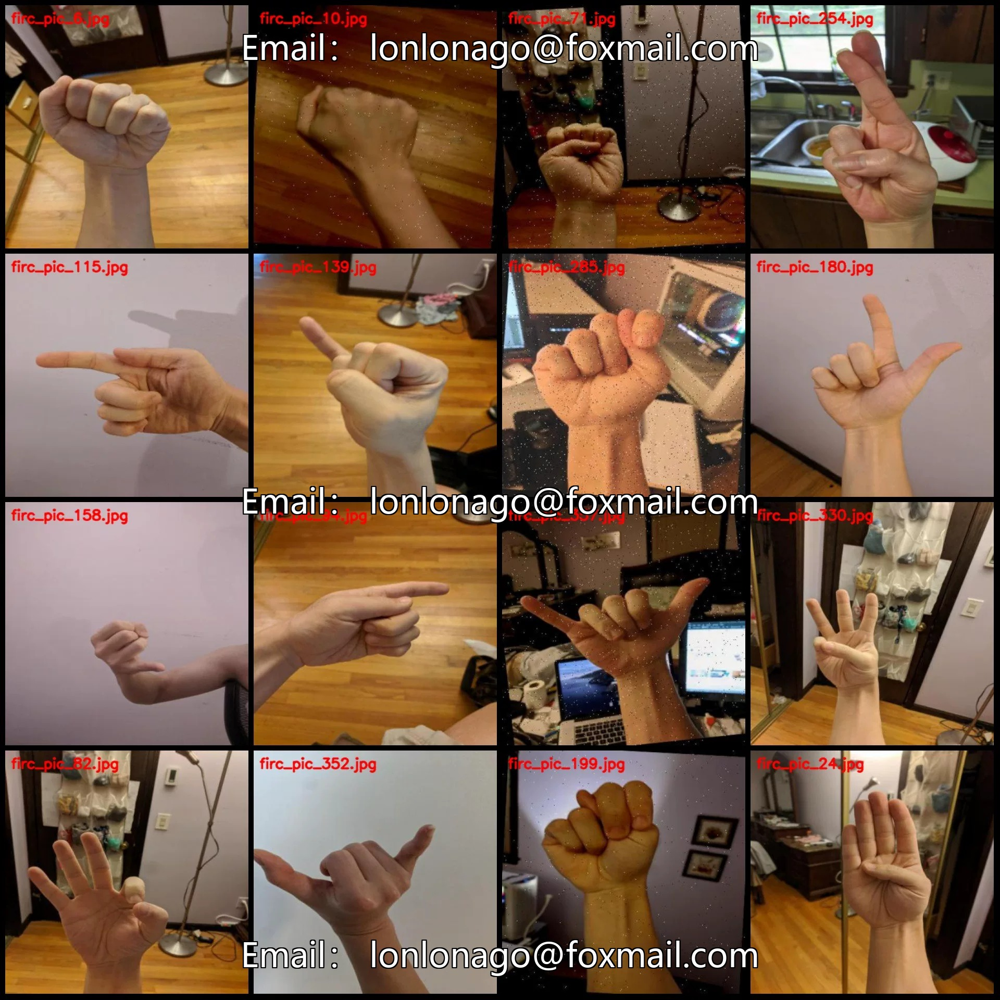
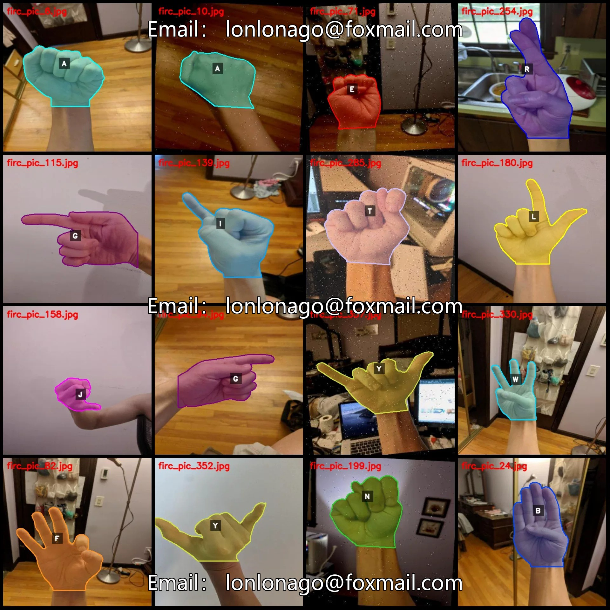
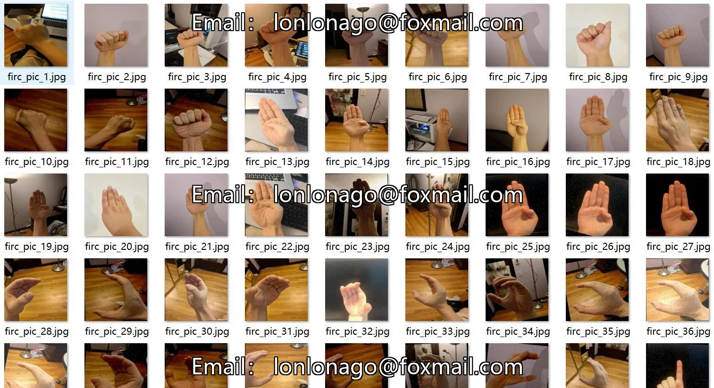
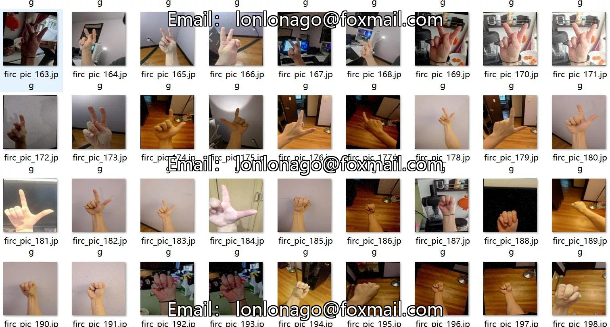
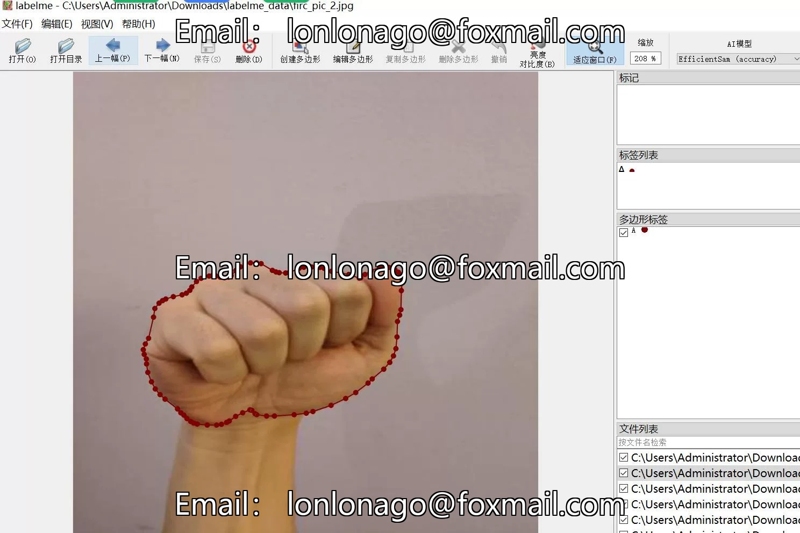

# Alphabet gesture recognition segmentation dataset in labelme format with 366 images and 26 categories

## Body

Alphabet gesture recognition segmentation dataset in labelme format with 366 images across 26 categories
Tips: Due to the dataset's replicability, please confirm compliance before purchasing.
Dataset format: labelme format (excluding mask files, only including jpg images and corresponding json files)
Number of images (number of jpg files): 366
Number of annotations (number of json files): 366
Number of annotation categories: 26

Annotation Category Names: ["A", "B", "C", "D", "E", "F", "G", "H", "I", "J", "K", "L", "M", "N", "O", "P", "Q", "R", "S", "T", "U", "V", "W", "X", "Y", "Z"]
Number of boxes per category and the number of images they occupy
- Boxes for category A = 13, occupying 12 images
- Boxes for category B = 15, occupying 15 images
- Boxes for category C = 17, occupying 17 images
- Boxes for category D = 16, occupying 16 images
- Boxes for category E = 12, occupying 12 images
- Boxes for category F = 21, occupying 21 images
- Boxes for category G = 22, occupying 22 images

H Frames = 14, Image Count = 14
I Frames = 13, Image Count = 13
J Frames = 19, Image Count = 19
K Frames = 12, Image Count = 12
L Frames = 11, Image Count = 11
M Frames = 10, Image Count = 10
N Frames = 17, Image Count = 17
O Frames = 13, Image Count = 13
P Frames = 10, Image Count = 10
Q Frames = 16, Image Count = 16
R Frames = 8, Image Count = 8
S Frames = 19, Image Count = 19
T Frames = 9, Image Count = 9
U Frames = 18, Image Count = 18
V Frames = 15, Image Count = 15

W box count = 13, occupied image count = 13
X box count = 15, occupied image count = 15
Y box count = 10, occupied image count = 10
Z box count = 9, occupied image count = 9
Total box count: 367
Using labelme tool: labelme=5.5.0
Image resolution: 416x416
Annotation rules: Polygons are drawn around the categories.
Important note: The dataset can be opened and edited using labelme. JSON datasets need to be converted into mask or yolo format or coco format for semantic segmentation or instance segmentation.
Special declaration: This dataset does not guarantee the accuracy of the trained models or weight files.

## Images

## Payment

Here is a pay link on Stripe ( https://buy.stripe.com/3cs8yP7sY87d0vu9AB ). Please contact me lonlonago@foxmail.com after funding $89, and I will send you a complete data files , thank you!

